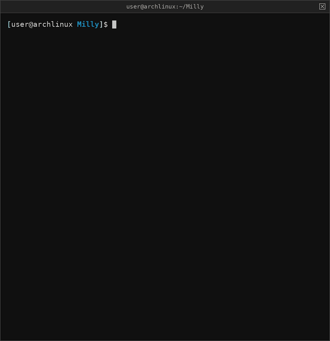
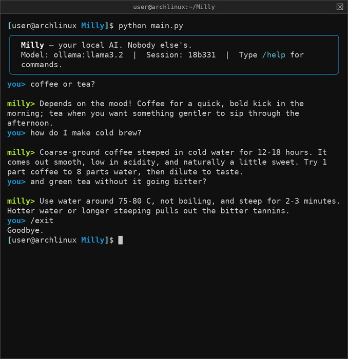

# Milly

> **Local LLM with a built-in security layer.**  
> Auditable. Offline. Yours.



---

## What It Does

Milly is a security-hardened terminal LLM chatbot. Local-first on Ollama, with optional support for other model providers. The security layer is structural, not bolted on.

- **Guardian layer** — prompt injection detection, input sanitization, output filtering — on every provider
- **Any model** — local Ollama models (llama, qwen3, gemma3, deepseek-r1, gpt-oss...), any OpenAI-compatible server (LM Studio, llama.cpp, vLLM, OpenRouter, OpenAI), or Claude via the Anthropic API
- **Thinking-model aware** — reasoning from thinking models is separated from the answer, hidden by default, never saved to history (`/think` to show it)
- **TF-IDF RAG engine** — local retrieval-augmented generation with no external API calls
- **Plain-JSON conversation memory** — readable session files at mode `0600`, written atomically
- **Full audit trail** — every inference, every session event, logged and attributable
- **Offline by default** — Ollama is the default provider; no telemetry, no call-home behavior. Cloud providers are opt-in and Milly warns you whenever one is active

---

## Security Architecture

```
┌──────────────────────────────────────────────┐
│                  User Input                  │
└───────────────────┬──────────────────────────┘
                    │
┌───────────────────▼──────────────────────────┐
│              Input Sanitizer                 │
│        (injection detection layer)           │
└───────────────────┬──────────────────────────┘
                    │
       ┌────────────┴────────────┐
       │                         │
┌──────▼──────┐         ┌────────▼────────┐
│  TF-IDF RAG │         │  Session Memory │
│   Retrieval │         │   (JSON, 0600)  │
│   (local)   │         │                 │
└──────┬──────┘         └────────┬────────┘
       │                         │
       └────────────┬────────────┘
                    │
┌───────────────────▼──────────────────────────┐
│         Model Provider (pluggable)           │
│  Ollama (default, local) · OpenAI-compatible │
│               · Anthropic                    │
└───────────────────┬──────────────────────────┘
                    │
┌───────────────────▼──────────────────────────┐
│              Audit Logger                    │
│     (tamper-evident inference record)        │
└──────────────────────────────────────────────┘
```

---

## Threat Mitigations

| Threat | Mitigation |
|--------|-----------|
| Prompt injection | Guardian pattern detection on every input, all providers |
| Prompt injection via RAG | Documents scanned at ingest; retrieved text wrapped as untrusted |
| Data exfiltration | Local Ollama by default; cloud providers are opt-in and flagged in the UI |
| Unsafe output | Guardian output filtering on every streamed token |
| Snooping on history | Session files and logs created at mode `0600` |

---

## Quick Start

**1. Install Ollama**

- **Mac:** Download the app from [ollama.com/download](https://ollama.com/download)
- **Linux:** `curl -fsSL https://ollama.com/install.sh | sh`

**2. Pull a model**

```bash
ollama pull llama3.2       # default, ~2GB
ollama pull gemma3:1b      # lightweight alternative, ~800MB
```

**3. Clone and run**

```bash
git clone https://github.com/noisyloop/Milly
cd Milly
python3 -m venv venv
source venv/bin/activate
pip install -r requirements.txt

export OLLAMA_NO_ANALYTICS=1
python main.py
```

**Launch options**

```bash
python main.py --model qwen3:8b                      # pick a model
python main.py --model anthropic:claude-opus-5-5     # pick provider + model
python main.py --provider openai --model gpt-5       # same, separately
python main.py --session work                        # resume (or create) a named session
```

Inside Milly, arrow keys edit the line and up/down recall earlier prompts.
Ctrl+C stops a reply mid-stream without quitting.

---

### What it looks like



A plain conversation with a local model. Replies stream in and word-wrap to
your terminal width.

The demo is a real Milly session recorded in a pseudo-terminal. Only the model
is stubbed out, so it can be regenerated anywhere without Ollama:

```bash
pip install pexpect pyte pillow
python scripts/demo/make_demo.py      # writes assets/demo.gif + assets/screenshot.png
```

---

## Test Suite

```bash
pytest -v
```

Security properties are tested, not documented. If it's not in the test suite, it's not a feature.

---

## Configuration

Milly reads `config.yaml` from the project root on startup. Every option has a
built-in default, so Milly runs even if the file is missing or incomplete.

```yaml
provider: ollama                       # which provider to start with
default_model: llama3.2                # model for that provider
temperature: 0.7                       # 0.0 = deterministic, 1.0 = creative
show_thinking: false                   # show reasoning from thinking models
guardian_enabled: true                 # Master switch for security checks
guardian_sensitivity: medium           # low | medium | high
max_input_length: 4000                 # Reject inputs longer than this
audit_logging: true                    # Write events to logs/security.log
```

### Model providers

Providers are defined under `providers:` in `config.yaml`. Three are built in:

| Provider | Type | Needs | Local? |
|----------|------|-------|--------|
| `ollama` | Ollama | Ollama running | Yes |
| `openai` | OpenAI-compatible | `pip install openai`, `OPENAI_API_KEY` | No |
| `anthropic` | Anthropic | `pip install anthropic`, `ANTHROPIC_API_KEY` | No |

Add your own named entries for other OpenAI-compatible servers. Mark
local servers `local: true` so Milly doesn't show the cloud warning:

```yaml
providers:
  lmstudio:
    type: openai
    base_url: http://localhost:1234/v1
    local: true
  openrouter:
    type: openai
    base_url: https://openrouter.ai/api/v1
    api_key_env: OPENROUTER_API_KEY
```

Then switch with `/provider lmstudio` or `/model lmstudio:qwen3-8b`. API keys
are read from environment variables, so they never end up in the config file.
The optional SDKs are only needed for the providers you actually use.

**Thinking models.** Reasoning arrives either in a separate field (newer
Ollama, OpenAI-compatible `reasoning_content`) or inline as `<think>…</think>`
tags. Milly handles both: reasoning is hidden by default, shown dimmed with
`/think`, and never written to session history.

**Claude models.** Temperature isn't sent (current Claude models don't accept
it). `effort` and `max_tokens` can be set under `providers.anthropic`. On
models that support it, Milly turns on the API's server-side refusal fallback,
so a declined request is retried on a fallback model automatically.

### Guardian sensitivity

The Guardian detection layer has three tiers, set via `guardian_sensitivity`:

| Level | Behavior |
|-------|----------|
| `low` | Flags only the most obvious attacks — direct instruction substitution and authority impersonation |
| `medium` | Default. Balanced OWASP LLM Top 10 pattern set |
| `high` | Flags merely suspicious phrasing too — hypothetical framing, encoded/obfuscated payloads |

Run `/guardian` inside Milly to see the active level, pattern counts, and
detection stats for the session.

### Custom detection patterns

Add your own injection-detection patterns without touching `guardian.py`:
edit `custom_patterns.txt` in the project root, one regex per line. Custom
patterns are always active regardless of the sensitivity tier. Lines starting
with `#` are comments; an optional TAB-separated name labels the pattern in
logs. See the file header for the full format.

### Audit export

Run `/audit export` to write the current session's audit log to a timestamped
file under `exports/` (e.g. `exports/audit_2026-06-27_session-abc123.json`).
Exports contain event metadata, timestamps, pattern types, and input *hashes*
only — never raw user input, matching the live audit log's privacy guarantee.

---

## Knowledge Base

Drop `.md` or `.txt` files into the `docs/` folder, then run `/ingest` inside Milly. It indexes them locally using TF-IDF and retrieves relevant context on each query. No embeddings API, no internet, no cloud.

Included reference docs:

| File | Contents |
|------|----------|
| `guardian.md` | Attack pattern reference for the Guardian layer |
| `threats.md` | Threat models for local LLMs with risk matrix |
| `owasp-llm.md` | OWASP LLM Top 10 mapped to Milly's mitigations |
| `researcher.md` | Operator context for security research use |
| `opsec.md` | Operational security principles |
| `security.md` | Security concepts reference |

Add your own docs to extend the knowledge base. Files you add to `docs/` stay on your machine unless you commit them. With a cloud provider active, the snippets retrieved for each question are sent along with your prompt.

---

## Commands

| Command | Description |
|---------|-------------|
| `/help` | Show commands |
| `/status` | Model, memory, RAG, and Guardian stats |
| `/audit` | Security event summary for this session |
| `/audit export` | Export this session's audit log to `exports/` |
| `/guardian` | Show Guardian sensitivity level and detection stats |
| `/ingest` | Re-index the `docs/` folder |
| `/clear` | Clear session history |
| `/session new NAME` | Start a new named session |
| `/session list` | List saved sessions |
| `/session load NAME` | Load a previous session |
| `/session delete NAME` | Delete a saved session |
| `/model NAME` | Switch model on the current provider (e.g. `/model qwen3:8b`) |
| `/model PROVIDER:NAME` | Switch provider and model (e.g. `/model anthropic:claude-opus-5-5`) |
| `/models` | List models available from the current provider |
| `/provider [NAME]` | List providers, or switch to one |
| `/think` | Show/hide reasoning from thinking models |
| `/exit` | Quit |

---

## Tested Models

| Model | Size | Notes |
|-------|------|-------|
| llama3.2 | ~2GB | Default |
| gemma3:1b | ~800MB | Lightweight, fast |
| qwen3:8b | ~5GB | Thinking model — reasoning hidden unless `/think` |
| deepseek-r1:8b | ~5GB | Thinking model (`<think>` tags handled) |
| gpt-oss:20b | ~14GB | Thinking model |
| mistral | ~4GB | Strong general purpose |

Any local model available via `ollama pull` should work — run `/models` to see
what's installed. Ollama `:cloud` models run on Ollama's servers, not yours, so
they break the offline guarantee.

---

## Offline Use

Once Ollama and your model are downloaded, Milly runs fully offline with the default `ollama` provider (or any `local: true` provider). No internet connection required. The `openai` and `anthropic` providers need network access and send your prompts to that service — Milly shows a warning in the banner, `/status`, and on every switch to one.

---

## Privacy Controls

**Disable Ollama analytics:**

```bash
export OLLAMA_NO_ANALYTICS=1
```

Add to your shell profile (`~/.zshrc` or `~/.bashrc`) to make it permanent.

**Clear saved conversations:**

Sessions are plain JSON files in `memory/`. Delete one with `/session delete NAME`, or all of them:

```bash
rm memory/*.json
```

Sessions saved by older versions (HMAC-signed) still load. If you have an old
`memory/.key` file, it's no longer used and can be deleted.

**Clear all local data:**

```bash
rm -rf memory/
```

**Clear security logs:**

```bash
rm logs/security.log
```

With a local provider nothing is sent anywhere. Everything Milly stores is in `memory/`, `logs/`, and `docs/` on your machine. Delete them and it's gone.

---

## License

MIT
